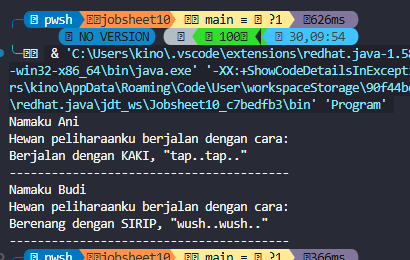
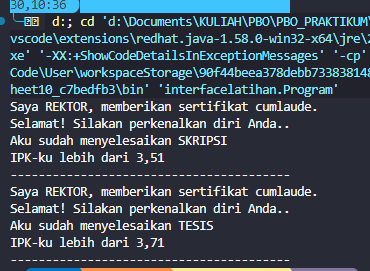
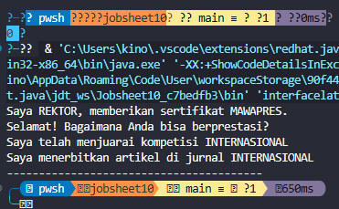
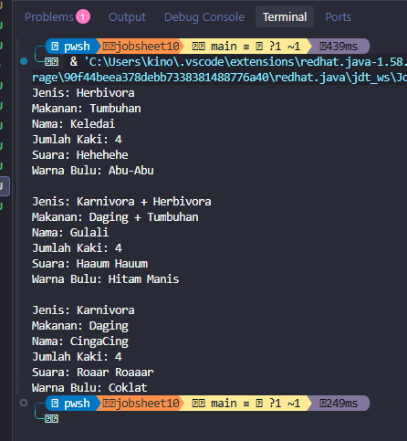

# Laporan Praktikum PBO - Jobsheet 10
## Abstract Class dan Interface

## Identitas

| Keterangan | Data |
| --- | --- |
| **Nama** | Muhammad Farhan |
| **NIM** | 264107023002 |
| **No** | 14 |
| **Kelas** | TI 2G |

---

## Tujuan Praktikum

1. Memahami konsep abstract class dan abstract method pada Java.
2. Memahami penggunaan interface sebagai kontrak perilaku suatu kelas.
3. Menerapkan inheritance, overriding, dan polymorphism pada program Java.
4. Menerapkan lebih dari satu interface pada sebuah class.

## Dasar Teori

**Abstract class** adalah class yang tidak dapat dibuat objeknya secara langsung. Class ini dapat memiliki atribut, constructor, method biasa, dan abstract method. Abstract method hanya memiliki deklarasi sehingga implementasinya wajib dibuat oleh subclass.

**Interface** adalah kontrak yang berisi method yang harus diimplementasikan oleh class. Sebuah class dapat mengimplementasikan lebih dari satu interface. Dengan interface, beberapa class yang tidak berada dalam satu hubungan inheritance tetap dapat diperlakukan berdasarkan kemampuan atau perilaku yang sama.

---

## Percobaan

### Percobaan 1: Abstract Class dan Abstract Method

Pada percobaan ini dibuat abstract class `Hewan` dengan atribut `umur`, method `bertambahUmur()`, dan abstract method `bergerak()`. Class `Kucing` dan `Ikan` mewarisi `Hewan` serta mengimplementasikan method `bergerak()` dengan perilaku yang berbeda. Class `Orang` menyimpan objek `Hewan` sebagai hewan peliharaan dan memanggil method `bergerak()` secara polymorphic.

**Hasil pengamatan**

| Objek | Implementasi `bergerak()` | Output |
| --- | --- | --- |
| `Kucing` | Berjalan menggunakan kaki | `Berjalan dengan KAKI, "tap..tap.."` |
| `Ikan` | Berenang menggunakan sirip | `Berenang dengan SIRIP, "wush..wush.."` |

#### Pertanyaan Percobaan 1

1. Abstract class digunakan sebagai class dasar yang menyediakan struktur umum bagi subclass.
2. Abstract class tidak dapat dibuat objeknya secara langsung karena masih memiliki abstract method yang belum memiliki implementasi.
3. Abstract method wajib di-*override* oleh subclass yang tidak dideklarasikan sebagai abstract.
4. Method `bergerak()` tetap dapat dipanggil melalui referensi `Hewan` karena implementasi yang dijalankan ditentukan oleh objek sebenarnya saat runtime.
5. Keuntungan penggunaan abstract class adalah kode umum dapat digunakan kembali, sedangkan perilaku khusus diserahkan kepada masing-masing subclass.

### Percobaan 2: Interface `ICumlaude`

Interface `ICumlaude` mendefinisikan method `lulus()` dan `meraihIPKTinggi()`. Class `Sarjana` dan `PascaSarjana` mengimplementasikan interface tersebut. Method pada `Rektor` menerima parameter bertipe `ICumlaude`, sehingga dapat digunakan untuk berbagai mahasiswa yang memenuhi kontrak interface.

**Hasil pengamatan**

| Objek | Implementasi `lulus()` | Implementasi `meraihIPKTinggi()` |
| --- | --- | --- |
| `Sarjana` | Menyelesaikan skripsi | IPK lebih dari 3,51 |
| `PascaSarjana` | Menyelesaikan tesis | IPK lebih dari 3,71 |

#### Pertanyaan Percobaan 2

1. Interface berfungsi sebagai kontrak yang menentukan method yang harus dimiliki oleh class implementasinya.
2. Parameter `ICumlaude` pada method `beriSertifikatCumlaude()` memungkinkan method tersebut menerima objek `Sarjana` maupun `PascaSarjana`.
3. `Sarjana` dan `PascaSarjana` dapat diproses dengan method yang sama, tetapi menghasilkan output sesuai implementasi masing-masing.
4. Perbedaan abstract class dan interface adalah abstract class dapat menyimpan state serta implementasi method, sedangkan interface terutama digunakan untuk mendefinisikan kemampuan yang harus dipenuhi class.

### Percobaan 3: Interface `IBerprestasi`

Interface `IBerprestasi` mendefinisikan method `menjuaraiKompetisi()` dan `membuatPublikasiIlmiah()`. Pada percobaan ini `PascaSarjana` mengimplementasikan dua interface, yaitu `ICumlaude` dan `IBerprestasi`. Rektor dapat memberikan sertifikat MAWAPRES melalui parameter bertipe `IBerprestasi`.

**Hasil pengamatan**

| Method | Hasil |
| --- | --- |
| `menjuaraiKompetisi()` | Mahasiswa menjuarai kompetisi internasional |
| `membuatPublikasiIlmiah()` | Mahasiswa menerbitkan artikel di jurnal internasional |

#### Pertanyaan Percobaan 3

1. Java mengizinkan sebuah class mengimplementasikan lebih dari satu interface.
2. `PascaSarjana` dapat menerima tanggung jawab dari `ICumlaude` dan `IBerprestasi` sekaligus.
3. Method `beriSertifikatMawapres()` hanya membutuhkan objek yang memenuhi kontrak `IBerprestasi`, sehingga tidak bergantung pada class konkret.
4. Penggunaan interface membuat program lebih fleksibel karena implementasi dapat ditukar tanpa mengubah kode pada class pemanggil.

---

## Tugas

### Tugas 1: Abstract Class dan Multiple Interface pada Binatang

Pada tugas ini dibuat abstract class `Binatang` yang menyimpan data umum berupa `nama` dan `jmlKaki`, serta method `displayBinatang()`. Interface `IHerbivora` dan `IKarnivora` masing-masing mendefinisikan method `displayMakan()`.

Class `Keledai` mengimplementasikan `IHerbivora`, class `Singa` mengimplementasikan `IKarnivora`, sedangkan class `Gorilla` mengimplementasikan kedua interface tersebut. Masing-masing objek menampilkan jenis makanan, nama, jumlah kaki, suara, dan warna bulu.

**Hasil pengamatan**

| Objek | Interface | Jenis makanan |
| --- | --- | --- |
| `Keledai` | `IHerbivora` | Tumbuhan |
| `Gorilla` | `IKarnivora`, `IHerbivora` | Daging + tumbuhan |
| `Singa` | `IKarnivora` | Daging |

Tugas ini membuktikan bahwa class dapat mewarisi implementasi umum dari abstract class sekaligus memiliki beberapa kemampuan melalui interface.

---

## Kesimpulan

Abstract class digunakan untuk membangun class dasar yang memiliki struktur dan perilaku umum, tetapi tidak dapat dibuat objeknya secara langsung. Subclass wajib mengimplementasikan abstract method yang diwarisinya.

Interface digunakan sebagai kontrak perilaku. Satu class dapat mengimplementasikan satu atau beberapa interface, sehingga program dapat menerapkan polymorphism berdasarkan kemampuan objek. Pada Jobsheet 10, konsep tersebut diterapkan pada hewan peliharaan, mahasiswa cumlaude, mahasiswa berprestasi, dan berbagai jenis binatang. Penerapan abstract class dan interface membuat kode lebih terstruktur, fleksibel, dapat digunakan kembali, dan mudah dikembangkan.
