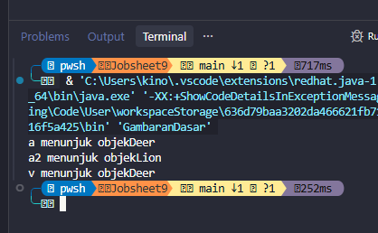
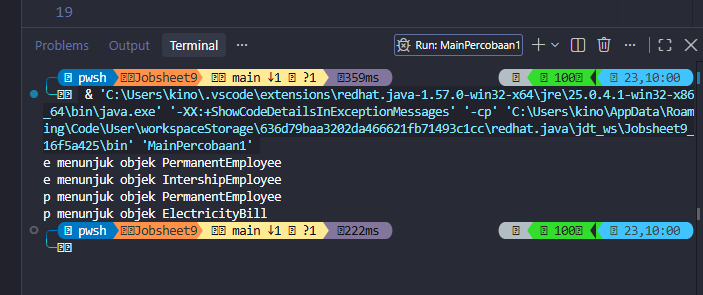
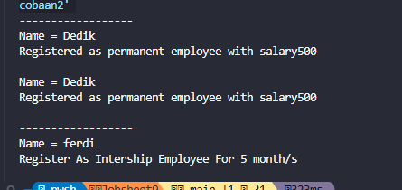
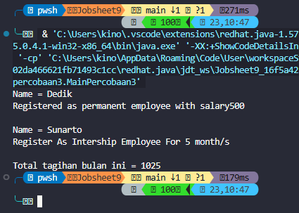
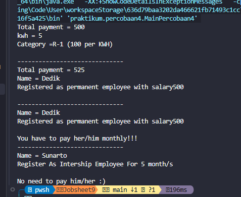
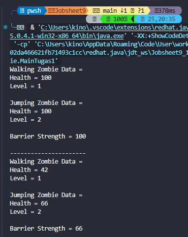
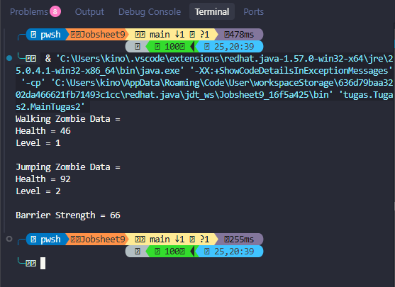
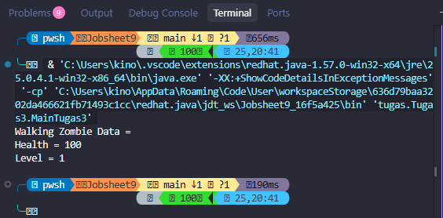

# Laporan Praktikum PBO � Pertemuan 9
## Polimorfisme

## Identitas

| Keterangan | Data |
| --- | --- |
| **Nama** | Muhammad Farhan |
| **NIM** | 264107023002 |
| **No** | 14 |
| **Kelas** | TI 2G |

---

## Percobaan

### Percobaan 1: Polimorfisme Dasar

#### Pertanyaan Percobaan 1

1. Penjelasan polimorfisme adalah kemampuan objek dari kelas berbeda untuk merespons panggilan method yang sama dengan cara yang berbeda-beda.
2. Polimorfisme memungkinkan penggunaan antarmuka umum untuk berbagai jenis objek implementasi.
3. Prinsip dasar polimorfisme meliputi: overloading (compile-time polymorphism) dan overriding (runtime polymorphism).
4. Contoh kasus: method suara() pada kelas Kucing dan Anjing akan menghasilkan output yang berbeda meskipun dipanggil dengan nama method yang sama.

**Tabel eksperimen**

| Eksperimen | Hasil |
| --- | --- |
| Implementasi method suara() pada kelas turunan | Setiap kelas memberikan output suara yang unik |
| Referensi superclass ke objek subclass | Method subclass yang di-override dieksekusi |
| Casting eksplisit ke tipe konkret | Akses method yang hanya ada di kelas tertentu |

### Percobaan 2: Method Overriding

**Tabel eksperimen**

| Perubahan | Hasil |
| --- | --- |
| Men-override method gerak() pada subclass | Subclass memiliki perilaku gerak yang berbeda |
| Memanggil super.gerak() dari subclass | Menjalankan implementasi superclass terlebih dahulu |
| Menghapus @Override annotation | Masih berfungsi tetapi tidak terdeteksi error compile |

#### Pertanyaan Percobaan 2

1. @Override digunakan untuk memastikan method di subclass benar-benar meng-override method superclass, dan membantu compiler mendeteksi kesalahan.
2. Method super.gerak() digunakan untuk memanggil implementasi method pada superclass, sering digunakan untuk memperluas (memperbaiki) perilaku yang sudah ada.
3. Aturan overriding: nama method harus sama, parameter harus sama, tipe kembalian bisa sama atau covariant, akses modifier tidak boleh lebih sempit dari superclass.
4. Jika subclass tidak meng-override method, maka implementasi superclass yang akan dieksekusi.

### Percobaan 3: Polimorfisme dengan Array

#### Pertanyaan Percobaan 3

1. Array dapat menyimpan referensi objek dari berbagai jenis subclass yang sama superclass.
2. Looping melalui array objek subclass akan memanggil method yang sesuai dengan kelas setiap objek.
3. Polimorfisme melalui array memungkinkan kode yang lebih fleksibel dan dapat diperluas.

**Tabel eksperimen**

| Eksperimen | Hasil |
| --- | --- |
| Menyimpan objek subclass ke array superclass | Setiap elemen array memiliki perilaku unik |
| Iterasi melalui array dan pemanggilan method | Setiap objek merespons sesuai kelasnya |
| Upcasting otomatis ke tipe superclass | Referensi objek tersimpan tanpa kehilangan tipe asli |

### Percobaan 4: Polimorfisme dengan Collection

#### Pertanyaan Percobaan 4

1. Collection Framework (seperti List, Set) dapat menyimpan objek-objek dari berbagai subclass.
2. Polimorfisme dengan collection memungkinkan manipulasi berbagai jenis objek dalam satu struktur data.
3. Iterator atau foreach loop akan memanggil method yang sesuai dengan tipe objek aktual.

**Tabel eksperimen**

| Eksperimen | Hasil |
| --- | --- |
| Menambahkan objek subclass ke List<Superclass> | Semua objek tersimpan meskipun tipe berbeda |
| Iterasi dengan foreach dan pemanggilan method | Setiap objek merespons sesuai implementasinya |
| Menambahkan objek ke Collection yang tidak kompatibel | Error compile atau runtime dependening on tipe |

## Tugas Mandiri

### Tugas 1: Polimorfisme pada Zombie

Output menunjukkan perbedaan perilaku `WalkingZombie` dan `JumpingZombie`, serta perubahan `Barrier` setelah menerima serangan.

### Tugas 2: Array Interface `Destroyable`

Objek `WalkingZombie`, `JumpingZombie`, dan `Barrier` dapat disimpan dalam array `Destroyable` karena ketiganya mengimplementasikan interface tersebut. Setelah proses penghancuran, objek zombie dapat dipulihkan menggunakan method `heal()`.

### Tugas 3: Upcasting dan Downcasting

`WalkingZombie` dapat di-*upcast* menjadi `Zombie` dan `Destroyable`, sedangkan *downcasting* hanya aman jika tipe objek sebenarnya sesuai. Komentar pada program menunjukkan contoh kode yang menghasilkan error kompilasi atau error saat dijalankan.

## Kesimpulan

Polimorfisme adalah konsep OOP yang memungkinkan objek dari kelas berbeda merespons panggilan method yang sama dengan cara yang berbeda-beda. Ada dua jenis polimorfisme utama:
1. **Overloading** (compile-time polymorphism): Multiple method dengan nama yang sama tetapi parameter berbeda dalam satu kelas.
2. **Overriding** (runtime polymorphism): Subclass mengganti implementasi method superclass.

Kunci pemahaman polimorfisme meliputi penggunaan 	his dan super, annotasi @Override, aturan akses modifier, serta perbedaan antara binding compile-time dan runtime. Polimorfisme memungkinkan kode yang lebih fleksibel, dapat diperluas, dan lebih mudah dipelihara.
